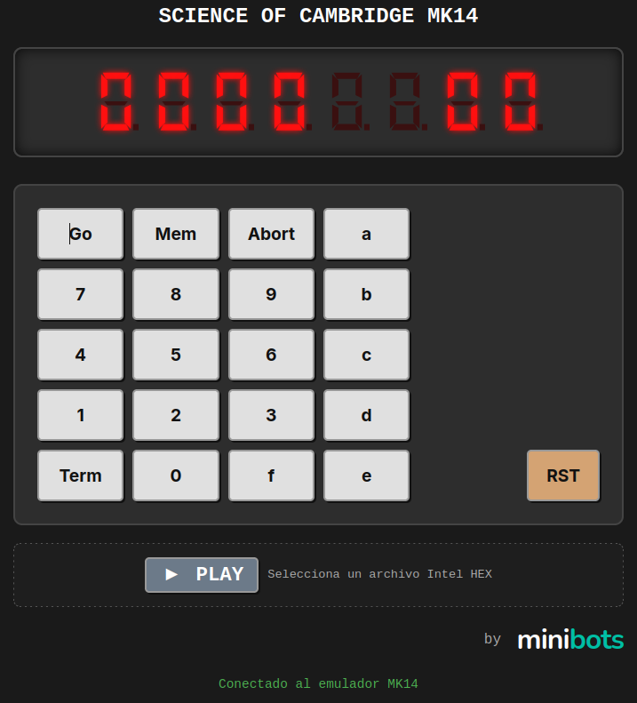

# MK14 ESP32 Emulator — SC/MP Emulator

**[English Version](#english-version)** | **[Versión en Español](#versión-en-español)**

## English Version

More information at [Minibots](https://minibots.wordpress.com/2026/10/14/emulador-de-science-of-cambridge-mk14-con-esp32/).

This project is a lightweight emulator of the **Science of Cambridge MK14 microcomputer**, based on the **National Semiconductor SC/MP II (INS8060) processor**, adapted to run on an ESP32 microcontroller using the Arduino framework.

The emulator reproduces the processor's execution, memory mapping, keyboard input, and seven-segment display behavior. It includes a browser-based interface for interacting with the emulated machine and loading programs in Intel HEX format.

### Key Features

- **SC/MP CPU Emulation:** Implements the instruction execution core, including the accumulator, extension register, status register, pointer registers, and instruction cycle accounting.

- **MK14 Memory Mapping:** Emulates the monitor ROM, user RAM, option memory, keyboard input, and display-mapped memory areas.

- **SCIOS Monitor ROM:** Includes the SCIOS ROM image used by the original MK14 environment.

- **Intel HEX Program Loading:** Upload program files through the web interface. The loader validates record structure, byte counts, checksums, end-of-file records, and supported address ranges before applying the program to emulated memory.

- **Browser-Based Interface:** Access the emulator from a web browser over Wi-Fi, without requiring a separate serial terminal for normal interaction.

- **Interactive Keyboard and Display:** Send virtual key presses through the browser and receive display updates over WebSocket.

- **ESP32 Execution Scheduling:** Runs the emulation in a dedicated FreeRTOS task, with configurable execution pacing and display-update throttling to reduce unnecessary network traffic.

### System Architecture

- **ESP32 Host Layer:** Firmware developed with the Arduino framework and built using PlatformIO.

- **CPU Emulation Core:** Implements the SC/MP instruction execution loop and maintains the processor's registers and cycle count.

- **Memory Bus Mapping:** Provides separate behavior for monitor ROM, user RAM, option memory, keyboard reads, and display writes.

- **Web Interface:** An asynchronous HTTP server serves the browser interface, while a WebSocket connection handles keyboard events and display updates.

- **Program Memory:** User programs are loaded into the emulated RAM. The program-memory clearing routine preserves the first `0x12` bytes of the `0xF00` memory page, which are reserved for monitor workspace.

### Quick Start Guide

1. **Build and Upload:** Open the project in PlatformIO, select the appropriate ESP32 environment, and compile and upload the firmware to your board.

2. **Connect to Wi-Fi:** Configure the network credentials in the project's `secrets.h` file and start the emulator.

3. **Open the Web Interface:** Check the serial output for the ESP32's IP address and open the corresponding URL in a browser.

4. **Load a Program:** Use the browser interface to upload a compatible Intel HEX file.

5. **Execute the Program:** Enter the appropriate start address and use the interface's execution control to run the program. The correct entry point depends on the program being loaded.

### Requirements

- **Hardware:** An ESP32 development board with sufficient flash and RAM for the firmware.

- **Software Environment:** PlatformIO with the Espressif 32 platform and the Arduino framework.

- **Network:** A Wi-Fi network accessible to the ESP32 and the browser used to control the emulator.

- **Program Files:** Intel HEX files containing code compatible with the emulated MK14 memory map and SC/MP processor.

### Limitations

- Intel HEX is a file format, not a guarantee of processor compatibility. Programs must contain machine code intended for the SC/MP and use valid addresses in the emulator's memory map.

- The emulator reproduces selected MK14 hardware and monitor behavior in software; it is not a cycle-accurate simulation of every electrical characteristic of the original hardware.

### License

This project is licensed under the GNU General Public License v2.0 (GPL-2.0). See the LICENSE file for details.

This project incorporates code reused from Ardu14, originally authored by Johannes le Roux, Copyright (c) 2023, and distributed under the MIT License. The applicable MIT copyright notice and license terms are retained for the reused code.

The GPL-2.0 license applies to this project as a whole, subject to the applicable terms and notices for third-party components. See the relevant source files and license notices for details.

---

## Versión en Español

Más información en [Minibots](https://minibots.wordpress.com/2026/10/14/emulador-de-science-of-cambridge-mk14-con-esp32/).

Este proyecto es un emulador ligero del **microordenador MK14 de Science of Cambridge**, basado en el **procesador SC/MP II (INS8060) de National Semiconductor**, adaptado para ejecutarse en un microcontrolador ESP32 mediante el entorno Arduino.

El emulador reproduce la ejecución del procesador, el mapa de memoria, la entrada del teclado y el comportamiento del display de siete segmentos. Incluye una interfaz web para interactuar con la máquina emulada y cargar programas en formato Intel HEX.

### Características Principales

- **Emulación de la CPU SC/MP:** Implementa el núcleo de ejecución de instrucciones, incluyendo el acumulador, el registro de extensión, el registro de estado, los registros puntero y el recuento de ciclos de ejecución.

- **Mapa de Memoria del MK14:** Emula la ROM del monitor, la RAM de usuario, la memoria de opciones, la entrada del teclado y las zonas de memoria asociadas al display.

- **ROM del Monitor SCIOS:** Incorpora la imagen de la ROM SCIOS utilizada en el entorno del MK14 original.

- **Carga de Programas Intel HEX:** Permite cargar archivos de programa desde la interfaz web. El cargador valida la estructura de los registros, el número de bytes, los checksums, el registro de fin de archivo y los rangos de direcciones admitidos antes de aplicar el programa a la memoria emulada.

- **Interfaz Web:** Acceso al emulador desde un navegador mediante Wi-Fi, sin necesidad de utilizar una terminal serie independiente para la interacción habitual.

- **Teclado y Display Interactivos:** Permite enviar pulsaciones virtuales desde el navegador y recibir actualizaciones del display mediante WebSocket.

- **Planificación de Ejecución en ESP32:** Ejecuta la emulación en una tarea FreeRTOS independiente, con control del ritmo de ejecución y limitación de las actualizaciones del display para reducir el tráfico de red innecesario.

### Arquitectura del Sistema

- **Capa Host ESP32:** Firmware desarrollado con el framework Arduino y compilado mediante PlatformIO.

- **Núcleo de Emulación de la CPU:** Implementa el ciclo de ejecución de instrucciones SC/MP y mantiene los registros del procesador y el contador de ciclos.

- **Mapa del Bus de Memoria:** Gestiona por separado la ROM del monitor, la RAM de usuario, la memoria de opciones, las lecturas del teclado y las escrituras en el display.

- **Interfaz Web:** Un servidor HTTP asíncrono proporciona la interfaz del navegador, mientras que una conexión WebSocket gestiona los eventos del teclado y las actualizaciones del display.

- **Memoria de Programa:** Los programas del usuario se cargan en la RAM emulada. La rutina de borrado preserva los primeros `0x12` bytes de la página de memoria `0xF00`, reservados para el área de trabajo del monitor.

### Guía Rápida de Uso

1. **Compilación y Grabación:** Abre el proyecto en PlatformIO, selecciona el entorno ESP32 correspondiente y compila y graba el firmware en la placa.

2. **Conexión Wi-Fi:** Configura las credenciales de red en el archivo `secrets.h` del proyecto e inicia el emulador.

3. **Acceso a la Interfaz Web:** Consulta la salida serie para conocer la dirección IP del ESP32 y abre la URL correspondiente en el navegador.

4. **Carga de un Programa:** Utiliza la interfaz web para cargar un archivo Intel HEX compatible.

5. **Ejecución del Programa:** Introduce la dirección inicial adecuada y utiliza el control de ejecución de la interfaz. El punto de entrada depende del programa cargado.

### Requisitos

- **Hardware:** Placa de desarrollo ESP32 con memoria flash y RAM suficientes para ejecutar el firmware.

- **Entorno de Desarrollo:** PlatformIO con la plataforma Espressif 32 y el framework Arduino.

- **Red:** Una red Wi-Fi accesible tanto para el ESP32 como para el navegador utilizado para controlar el emulador.

- **Archivos de Programa:** Archivos Intel HEX con código máquina compatible con el procesador SC/MP y el mapa de memoria del MK14 emulado.

### Limitaciones

- Intel HEX es un formato de archivo, no una garantía de compatibilidad con el procesador. Los programas deben contener código máquina destinado al SC/MP y utilizar direcciones válidas dentro del mapa de memoria del emulador.

- El emulador reproduce mediante software determinadas funciones del hardware y del monitor del MK14; no pretende simular con precisión de ciclo todas las características eléctricas del equipo original.

### Licencia

Este proyecto se distribuye bajo la GNU General Public License v2.0 (GPL-2.0). Consulta el archivo LICENSE para más información.

El proyecto incorpora código reutilizado de Ardu14, cuyo autor original es Johannes le Roux, Copyright (c) 2023, distribuido bajo la licencia MIT. Se conservan el aviso de copyright y los términos de la licencia MIT aplicables al código reutilizado.

La GPL-2.0 se aplica al proyecto en su conjunto, respetando las condiciones y los avisos correspondientes a los componentes de terceros. Consulta los archivos fuente y los avisos de licencia pertinentes para más detalles.
